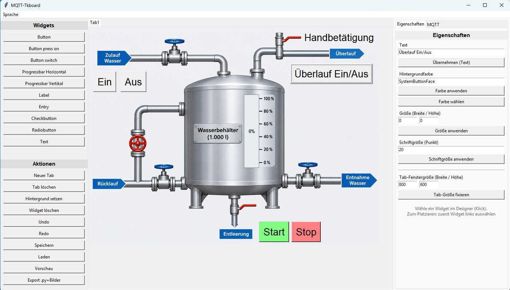
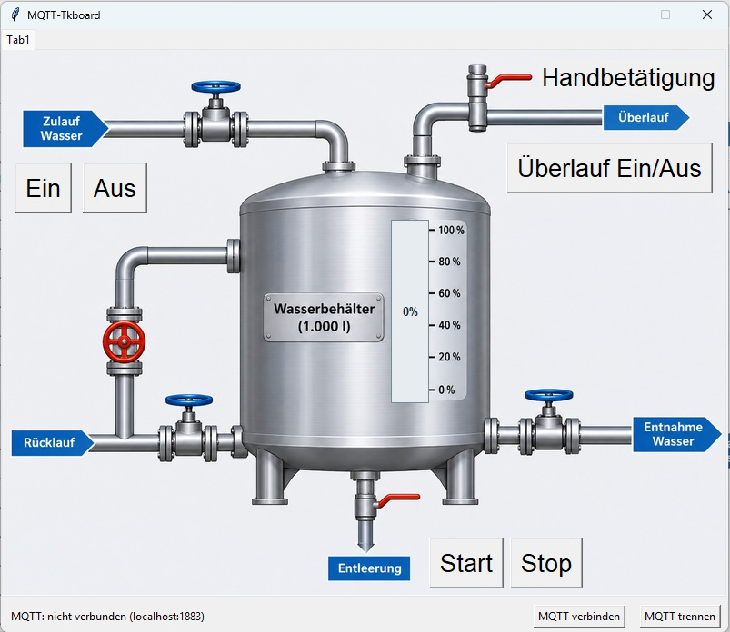

# MQTT-Tkboard

**MQTT-Tkboard** is a Python desktop GUI designer for building custom MQTT dashboards with Tkinter. Create and arrange widgets visually, connect them to MQTT topics, and export your dashboard as a standalone Python script.

## Features

- Drag and position interface widgets across multiple tabs.
- MQTT buttons: momentary **press on** (`on` while pressed, `off` when released), toggle **switch** (`on`/`off`), and checkbuttons (`on`/`off`).
- Horizontal and vertical progress bars displaying incoming MQTT values from **0 to 100**.
- MQTT publish/subscribe topics, connection controls, and value-based widget color rules.
- Customize widget text, colors, sizes, and font sizes; add background images.
- Save and load layouts, use undo/redo, preview designs, and export Python code with images.
- Switch the designer interface between **English and German** without changing widget names.

## Requirements

- Python 3 with Tkinter
- [Pillow](https://pypi.org/project/pillow/)
- [paho-mqtt](https://pypi.org/project/paho-mqtt/)

Install the Python dependencies:

```bash
python -m pip install pillow paho-mqtt
```

## Getting Started

```bash
python mqtt_tkboard_v1_0.py
```

1. Choose a widget from the left panel, then click the workspace to place it.
2. Select the widget and configure its properties and MQTT topics on the right.
3. Apply the MQTT settings and connect to your MQTT broker.
4. Save your layout, preview it, or export it as a Python application.

**Note:** An MQTT broker is required for live messaging. The exported application includes MQTT connect/disconnect controls.




